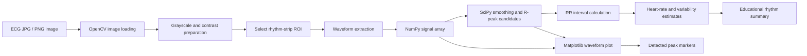

# Cardiac Abnormality Detection from ECG Images

A Python-based academic project that analyses a digitised ECG image, extracts a waveform from a selected rhythm-strip region, detects candidate R-peaks, estimates heart rate and evaluates beat-to-beat interval regularity.

> **Important:** This is an educational image-processing prototype, not a medical device. It cannot diagnose or rule out a cardiac condition. ECG interpretation must be performed by a qualified healthcare professional using the original clinical recording.

## System block diagram



## Features

- Loads ECG images in JPG, JPEG or PNG format.
- Uses OpenCV for image loading, grayscale conversion and image processing.
- Uses NumPy for waveform arrays and numerical calculations.
- Uses SciPy for smoothing and candidate peak detection.
- Uses Matplotlib to display the extracted waveform and candidate R-peaks.
- Estimates heart rate from detected inter-beat intervals.
- Calculates RR-interval standard deviation and coefficient of variation.
- Produces a cautious educational summary based on rate and rhythm regularity.

## Technology stack

| Library | Role |
|---|---|
| OpenCV (`cv2`) | Read and preprocess ECG image |
| NumPy | Numerical arrays and calculations |
| SciPy | Signal smoothing and peak detection |
| Matplotlib | Plot waveform and detected peaks |

## Repository structure

```text
.
├── README.md
├── requirements.txt
├── .gitignore
├── src/
│   └── ecg_image_analyzer.py
├── docs/
│   ├── algorithm.md
│   ├── system-architecture.md
│   ├── design-decisions.md
│   ├── testing.md
│   └── contribution-and-ai-disclosure.md
└── media/
    └── README.md
```

The existing repository licence is retained.

## Setup

Python 3.9 or newer is recommended.

```bash
git clone https://github.com/sdivyadarshan/Cardiac-Abnormality-Detection-from-jpg-using-Python.git
cd Cardiac-Abnormality-Detection-from-jpg-using-Python
python -m pip install -r requirements.txt
```

## Run

Place an ECG image on your computer and run:

```bash
python src/ecg_image_analyzer.py path/to/ecg_image.jpg --duration 10
```

The default region is the lower rhythm-strip area of a conventional 12-lead ECG page. If your image has a different layout, supply a crop as pixel coordinates:

```bash
python src/ecg_image_analyzer.py path/to/ecg_image.jpg --roi 40 580 1400 150 --duration 10
```

The ROI arguments are `x y width height`. Set `--duration` to the actual time represented by the selected strip. A wrong crop or duration will produce a wrong estimate. Inspect the plot before interpreting the report.

## How it works

1. Read the ECG raster image.
2. Convert the selected region to grayscale and create a binary mask of the dark trace.
3. Estimate one waveform value per image column from the trace pixels.
4. Smooth the extracted waveform to reduce small pixel-level variations.
5. Use SciPy peak detection to identify candidate R-peaks with a minimum spacing constraint.
6. Convert peak-to-peak pixel distances into time using the supplied strip duration.
7. Calculate heart rate and RR-interval variability.
8. Plot the waveform and detected peak candidates for visual inspection.

See [docs/algorithm.md](docs/algorithm.md) and [docs/system-architecture.md](docs/system-architecture.md).

## Interpretation limits

- Image-derived peaks are candidates, not guaranteed physiological R-peaks.
- The supplied duration and selected crop must match the source ECG.
- A printed ECG may contain grid lines, text, calibration marks, multiple leads and artefacts that affect extraction.
- RR variability alone is not sufficient to diagnose arrhythmia.
- This prototype does not reliably measure PR interval, QRS duration or ST-segment changes from arbitrary ECG photographs.
- The sample code reports signal-processing estimates only. It must not be used for treatment decisions.

## Testing

The project discussion used four sample ECG images: ECG 1 and ECG 2 were treated as normal reference examples, ECG 3 as an arrhythmia example, and ECG 4 as an abnormal example. Previous runs showed inconsistent heart-rate and RR-variability estimates, so those samples are **not claimed as validated test results**. Follow the checklist in [docs/testing.md](docs/testing.md) and record actual results after running the current code with the original images.

## Contributions and AI disclosure

The project concept, sample selection, execution, visual review and iterative feedback came from the student project work. AI assistance was used to help organise documentation and prepare/refine code and explanations. Exact authorship of individual original implementation lines should be reviewed by the student before submission. Details are in [docs/contribution-and-ai-disclosure.md](docs/contribution-and-ai-disclosure.md).

## Documentation

- [Algorithm](docs/algorithm.md)
- [System architecture](docs/system-architecture.md)
- [Design decisions](docs/design-decisions.md)
- [Testing checklist](docs/testing.md)
- [Contribution and AI disclosure](docs/contribution-and-ai-disclosure.md)
- [Media instructions](media/README.md)

## Author

**sdivyadarshan** — Individual academic project.
