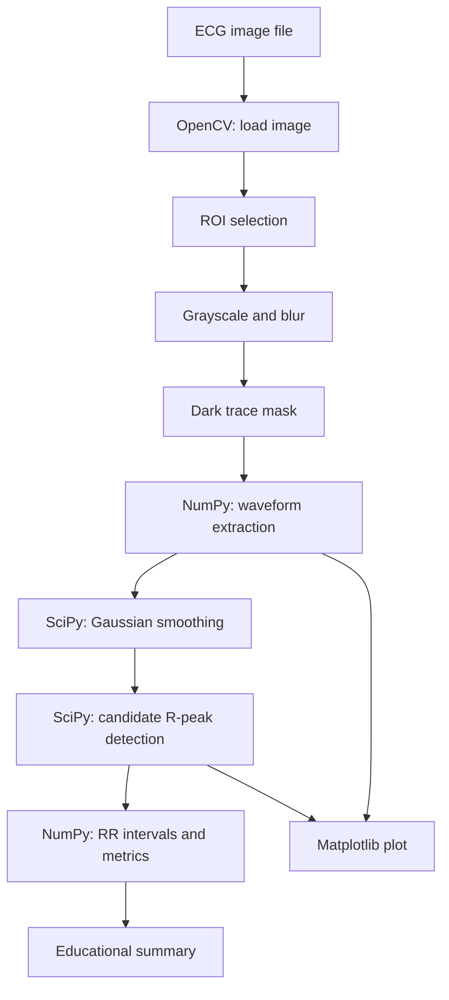

# System architecture

## Modules

- **Input layer:** accepts a local ECG image and command-line settings.
- **Image-processing layer:** selects the rhythm-strip region, converts it to grayscale and extracts a one-dimensional trace.
- **Signal-processing layer:** smooths the extracted sequence and identifies candidate peaks.
- **Analysis layer:** derives RR intervals, heart-rate estimate and variability statistics.
- **Presentation layer:** prints a text report and displays or saves a plot.

## Data flow

The image is transformed into a one-dimensional array of relative pixel amplitudes. Peak locations are measured in pixels and converted to time using the user-provided strip duration. Therefore crop selection and duration calibration directly affect the reported rate.
